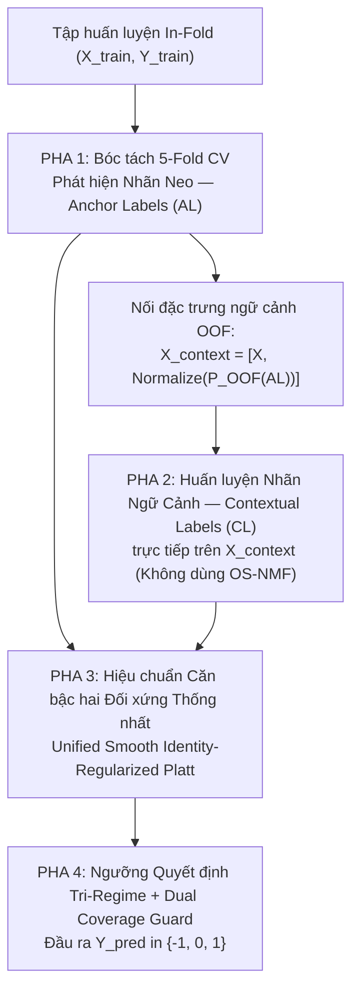

# TÀI LIỆU ĐẶC TẢ KỸ THUẬT: GSI-MLC-PA VỚI PHÂN TÁCH NHÃN NEO – NGỮ CẢNH (ANCHOR / CONTEXTUAL CASCADE) VÀ HIỆU CHUẨN CĂN BẬC HAI ĐỐI XỨNG THỐNG NHẤT

**Tên dự án:** GSI-MLC-PA (Grouping & Selective Inference for Multi-Label Classification with Partial Abstention)  
**Tập tin đặc tả:** `spec/spec_v6_3_3.md`  
**Trạng thái:** Đặc tả kỹ thuật chính thức (Đã chuẩn hóa AL/CL, gỡ bỏ OS-NMF & hợp nhất Tail Calibrator)

---

## 1. Kiến Trúc Tổng Thể (4 Pha Mạch Lạc – Không OS-NMF)

---

## 2. Chuẩn Hóa Phân Tách Tập Nhãn: Anchor Labels (`AL`) & Contextual Labels (`CL`)

Thay thế thuật ngữ cũ (`IL` / `DL`) để tránh đụng độ ký hiệu *Deep Learning (`DL`)* và phản ánh đúng bản chất toán học của tiêu chí lọc OOF $\text{Selective-F1} \ge \tau$:

1. **Tập Nhãn Neo — Anchor Labels ($\mathcal{L}_{\text{anc}}$, ký hiệu `AL`):**
   - Gồm các nhãn có độ tin cậy dự đoán tự thân cao ($\text{Selective-F1}_{\text{OOF}} \ge \tau_{\text{f1}}$).
   - Được dự đoán trước và đóng vai trò "mỏ neo" cung cấp đặc trưng xác suất liên tục $\hat{P}(\mathcal{L}_{\text{anc}} \mid X)$ cho pha sau.
2. **Tập Nhãn Ngữ Cảnh — Contextual Labels ($\mathcal{L}_{\text{ctx}}$, ký hiệu `CL`):**
   - Gồm các nhãn khó hoặc mơ hồ còn lại ($\mathcal{L} \setminus \mathcal{L}_{\text{anc}}$).
   - Được dự đoán trực tiếp bởi các bộ phân loại nhị phân học trên không gian ngữ cảnh mở rộng $X_{\text{context}} = [X, \text{Normalize}(\hat{P}(\mathcal{L}_{\text{anc}}))]$, **loại bỏ hoàn toàn** bước tính tương quan phần dư và ghép nối trường trung bình `OS-NMF`.

---

## 3. Bộ Hiệu Chuẩn Xác Suất Đuôi Thống Nhất (Unified Smooth Balanced-Root Platt)

Đối với mỗi nhãn $l \in \{0, \dots, K-1\}$ với $N_1$ mẫu dương và $N_0$ mẫu âm trên xác suất OOF $p_i \in (0, 1)$, đặt $z_i = \log\frac{p_i}{1 - p_i}$:

1. **Trọng số cân bằng căn bậc hai chuẩn hóa trung bình (liên tục trơn trên toàn miền $\pi_l \in (0, 1)$):**
   $$w_i = \begin{cases} \sqrt{N_0 / N_1}, & y_i = 1 \\ 1, & y_i = 0 \end{cases}, \qquad \tilde{w}_i = \frac{w_i}{\frac{1}{N}\sum_{k=1}^N w_k}$$
   - Khi $\pi_l < 0.50$: $\tilde{w}_+ > \tilde{w}_-$ (bảo vệ lớp dương thiểu số).
   - Khi $\pi_l = 0.50$: $\tilde{w}_+ = \tilde{w}_- = 1$ (tự động trở thành Platt chuẩn không trọng số, hiệu chuẩn trơn cả `SVM` và `MLP` ở vùng cân bằng thay vì bỏ ngỏ bằng `IdentityCalibrator`).
   - Khi $\pi_l > 0.50$: $\tilde{w}_- / \tilde{w}_+ = \sqrt{N_1 / N_0} > 1$ (thỏa mãn **tính đối xứng kép chính xác** $f(1 - p; 1 - y) = 1 - f(p; y)$ mà không cần lớp `InvertedTailCalibrator` riêng).

2. **Chính quy hóa tâm đồng nhất $(a = 1, b = 0)$ lồi chặt (L-BFGS-B):**
   $$\min_{a \in [a_{\min}, a_{\max}],\, b} \; \frac{1}{N}\sum_{i=1}^N \tilde{w}_i \big(\log(1 + e^{a z_i + b}) - y_i(a z_i + b)\big) + \frac{\lambda_a}{2}(a - 1)^2 + \frac{\lambda_b}{2} b^2$$
   - Kéo $(a, b)$ về phép đồng nhất $(1, 0)$ thay vì $(0, 0)$ của `liblinear`, giữ nguyên độ phân tách logit và bảo đảm tính đơn điệu tăng nghiêm ngặt ($a \ge a_{\min} > 0$).
   - **Rào chắn mẫu siêu hiếm ($\min(N_1, N_0) < 3$):** Khóa cứng hệ số góc $a = 1.0$ và chỉ tối ưu độ dịch chặn $b$ để chống overfit khi nhãn chỉ có 1–2 mẫu thiểu số.

---

## 4. Tầng Ra Quyết Định Tri-Regime & Rào Chắn Độ Phủ Kép

- Kết hợp ngưỡng Chow đối xứng $[c, 1-c]$ và ngưỡng Tỷ số Hợp lý Bayes bất đối xứng qua hàm chuyển tiếp Sigmoid tại $\tau_{\text{balance}} = 0.85$.
- Áp dụng `apply_dual_coverage_guard` trên xác suất OOF đã hiệu chuẩn với mục tiêu độ phủ huấn luyện $\gamma_{\min} = 0.70$ và rào chắn độ chính xác hai chiều ($\tau_1 \ge 0.50$ khi $\pi_l \le 0.50$; $\tau_0 \le 0.50$ khi $\pi_l > 0.50$).
- Hỗ trợ truyền động tham số `cost` tại thời điểm suy diễn `predict(X, cost=...)`.
