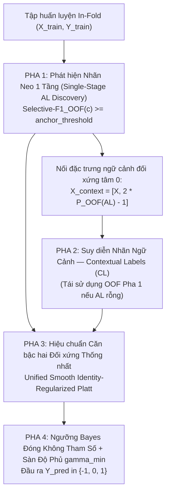

# TÀI LIỆU ĐẶC TẢ KỸ THUẬT: GSI-MLC-PA VỚI KIẾN TRÚC TỐI GIẢN 3 SIÊU THAM SỐ

**Tên dự án:** GSI-MLC-PA (Grouping & Selective Inference for Multi-Label Classification with Partial Abstention)  
**Tập tin đặc tả:** `spec/spec_v6_3_3.md`  
**Trạng thái:** Đặc tả kỹ thuật chính thức (Tối giản còn 3 siêu tham số cốt lõi: `cost`, `anchor_threshold`, `gamma_min`)

---

## 1. Kiến Trúc Tổng Thể (4 Pha – 3 Siêu Tham Số Cốt Lõi)

Toàn bộ mô hình chỉ sử dụng **3 siêu tham số điều khiển thuật toán/bài toán**:
1. **`cost`** ($c \in (0, 0.5)$, mặc định `0.30`): Chi phí từ chối dự đoán theo định nghĩa bài toán Partial Abstention.
2. **`anchor_threshold`** ($\tau_{\text{anc}}$, mặc định `0.75`): Ngưỡng $\text{Selective-F1}_{\text{OOF}}$ để phân tách Nhãn Neo (`AL`) và Nhãn Ngữ Cảnh (`CL`).
3. **`gamma_min`** ($\gamma_{\min} \in [0, 1]$, mặc định `0.70`): Sàn độ phủ mục tiêu trên xác suất OOF huấn luyện ở tầng ra quyết định.

---

## 2. Phân Tách 1 Tầng: Anchor Labels (`AL`) & Contextual Labels (`CL`)

1. **Pha 1 — Phát hiện Nhãn Neo 1 tầng ($\mathcal{L}_{\text{anc}}$, ký hiệu `AL`):**
   - Đánh giá độc lập từng nhãn qua $K$-fold CV trên $X$ tại chi phí từ chối $c$.
   - Nhãn đạt $\text{Selective-F1}_{\text{OOF}} \ge \tau_{\text{anc}}$ thuộc $\mathcal{L}_{\text{anc}}$; phần còn lại thuộc $\mathcal{L}_{\text{ctx}} = \mathcal{L} \setminus \mathcal{L}_{\text{anc}}$ (`CL`).
2. **Pha 2 — Suy diễn Ngữ cảnh Tâm 0 ($\mathcal{L}_{\text{ctx}}$, ký hiệu `CL`):**
   - Khi $\mathcal{L}_{\text{anc}} \neq \emptyset$: Chuẩn hóa đối xứng xác suất neo về $[-1, 1]$ quanh điểm trung lập $0$:
     $$X_{\text{context}} = \big[\,X,\; 2\hat{P}(\mathcal{L}_{\text{anc}}) - 1\,\big]$$
   - Khi $\mathcal{L}_{\text{anc}} = \emptyset$: $X_{\text{context}} = X$, tái sử dụng trực tiếp xác suất OOF từ Pha 1 mà không chạy lặp CV dư thừa.

---

## 3. Bộ Hiệu Chuẩn Xác Suất Đuôi Thống Nhất (Unified Smooth Balanced-Root Platt)

Với mỗi nhãn $l$ có $N_1$ mẫu dương, $N_0$ mẫu âm và $z_i = \log\frac{p_i}{1 - p_i}$:

$$w_i = \begin{cases} \sqrt{N_0 / N_1}, & y_i = 1 \\ 1, & y_i = 0 \end{cases}, \qquad \tilde{w}_i = \frac{w_i}{\frac{1}{N}\sum_{k=1}^N w_k}$$

$$\min_{a \in [a_{\min}, a_{\max}],\, b} \; \frac{1}{N}\sum_{i=1}^N \tilde{w}_i \big(\log(1 + e^{a z_i + b}) - y_i(a z_i + b)\big) + \frac{\lambda_a}{2}(a - 1)^2 + \frac{\lambda_b}{2} b^2$$

- Liên tục trơn trên toàn miền $\pi_l \in (0, 1)$, thỏa mãn đối xứng kép chính xác $f(1 - p; 1 - y) = 1 - f(p; y)$.
- Khóa hệ số góc $a = 1.0$ khi $\min(N_1, N_0) < 3$ để chống overfit mẫu siêu hiếm.

---

## 4. Ngưỡng Quyết Định Bayes Đóng Không Tham Số & Rào Chắn Độ Phủ

1. **Công thức đóng Bayes điều chỉnh theo tiên nghiệm $\pi_l$ (không cần siêu tham số phụ):**
   $$\tau_0(\pi_l, c) = \min\!\left(0.50,\; \frac{c\,\pi_l}{c\,\pi_l + (1-c)(1-\pi_l)}\right), \qquad \tau_1(\pi_l, c) = \max\!\left(0.50,\; \frac{(1-c)\,\pi_l}{(1-c)\,\pi_l + c(1-\pi_l)}\right)$$
   - Tự động trùng khớp quy tắc Chow đối xứng $[c, 1-c]$ tại $\pi_l = 0.50$ và liên tục toàn cục trên $(0, 1)$.
   - Thỏa mãn đối xứng kép $\tau_0(1-\pi_l, c) = 1 - \tau_1(\pi_l, c)$ mà không cần rẽ nhánh chế độ hay trộn Sigmoid.
2. **Sàn độ phủ OOF ($\gamma_{\min}$):** Co hẹp $[\tau_0, \tau_1]$ trên xác suất OOF huấn luyện khi độ phủ thực nghiệm $< \gamma_{\min}$, luôn bảo toàn bất biến $\tau_0 \le 0.50 \le \tau_1$.
